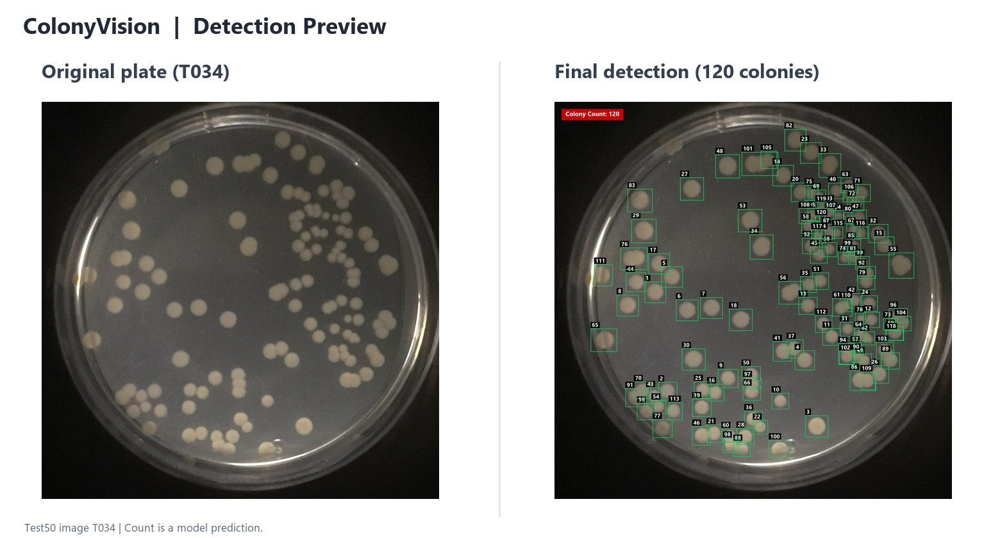

# ColonyVision


**ColonyVision** is a computer vision project for detecting and counting bacterial colonies in Petri-dish images. It combines a fine-tuned YOLO11n model with image preprocessing and post-processing techniques to reduce duplicate detections and improve colony counting, particularly for small and closely spaced colonies.

The project was developed as part of a university Computer Vision course, focusing on practical challenges in automated colony detection and counting.

## Overview

Rather than counting YOLO detections directly, ColonyVision applies multiple refinement stages before generating a final count.

**What This Project Does**
- Detects the Petri-dish boundary and crops the counting region (ROI).
- Applies CLAHE to improve local contrast.
- Uses overlapping image tiles with a fine-tuned YOLO11n model.
- Filters duplicate and unreliable bounding boxes.
- Examines touching colonies using Lobe Graph and Seeded-Connected analysis.
- Re-checks nested detections and displays the final boxes and colony count.

The final result displays green rectangular bounding boxes, numbered tags, and a colony count. Counts greater than 300 also show a **TNTC** display indicator; this is not a validated laboratory determination.



## How It Works

1. **Plate detection & preprocessing** — Find the dish, crop the image, and define an inner circular ROI.
2. **YOLO11n detection** — Detect candidate colonies from original and enhanced overlapping image tiles.
3. **Detection refinement** — Merge and filter duplicated or incorrect bounding boxes.
4. **Colony resolution** — Use pixel evidence to inspect touching colonies and nested boxes.
5. **Final counting** — Count accepted detections inside the ROI and render the results.

## Dataset & Model Training

The development dataset contains **1,200 images** from [Figshare](https://doi.org/10.6084/m9.figshare.20109377), divided into:

| Split | Images |
|---|---:|
| Training | 900 |
| Validation | 100 |
| Test | 200 |

Since the original training data did not include complete human-verified bounding boxes, an ADBC-based **Teacher detector** generated pseudo-labels. After filtering and tiling, these were used to fine-tune a pretrained **YOLO11n Student** for a single class: **colony**.

The training configuration targeted 50 epochs, and the available log records results through epoch 45. The final repository provides the trained Student model and a frozen evaluation subset, not the full training dataset or Teacher model.

## Evaluation & Results

The final system was evaluated on **50 held-out Test images (Test50)** using manually marked colony centers as Ground Truth. Of **3,698 manual points**, **3,650** were inside the defined counting ROI and included in evaluation.

Detection Precision, Recall, and F1-score are based on one-to-one matching between predicted box centers and manual points. **Count MAE** reports the average absolute difference in colony count per plate.

| Method | Precision | Recall | F1-score | Count MAE |
|---|---:|---:|---:|---:|
| YOLO Baseline | 80.00% | 95.53% | 87.08% | 14.18 |
| Refined | 92.73% | 96.08% | 94.38% | 3.80 |
| **Final Pipeline** | **97.07%** | **94.52%** | **95.78%** | **3.00** |

The complete pipeline increases F1-score from **87.08% to 95.78%** and reduces Count MAE from **14.18 to 3.00 colonies per plate** compared with the YOLO Baseline. Its Count RMSE is **6.03 colonies per plate**.

These are **point-based detection and counting results**, not classification accuracy or bounding-box mAP. The frozen results are recorded in `evaluation/test50/reference_metrics.csv`.

## Technologies Used

- Python
- Ultralytics YOLO11n / PyTorch
- OpenCV
- NumPy
- Pillow
- Matplotlib

## Setup & Installation

**Requirements:** Python 3.11 recommended, Git, and Git LFS. A CUDA-compatible GPU is optional.

**1. Clone the repository**

```powershell
git clone https://github.com/sSODAs/ColonyVision.git
cd ColonyVision
git lfs install
git lfs pull
```

**2. Install dependencies**

```powershell
python -m venv .venv
.\.venv\Scripts\Activate.ps1
pip install -r requirements.txt
```

**3. Run the Test50 evaluation**

```powershell
python run.py
```

For a quick check on the first five images:

```powershell
python run.py --limit 5 --output output/Test5_Preview
```

The default output is saved in `output/Test50_Final/`. Each image produces a final annotated result, a pipeline montage, a count-by-stage graph, and a JSON file with detected colony coordinates. **Note:** Each run replaces the selected output directory.

The included runner processes the frozen Test50 set; it is not a graphical image-upload application.

## Project Structure

```text
ColonyVision/
|-- config/                  # Inference settings
|-- evaluation/test50/       # Manual annotations and reference metrics
|-- raw/test50/              # Frozen 50-image evaluation set (Git LFS)
|-- src/                     # Detection, preprocessing, and post-processing
|-- weights/                 # Trained YOLO11n Student (Git LFS)
|-- images/preview.jpg       # README before/after example
|-- run.py                   # Test50 entry point
|-- requirements.txt
|-- README.md
```

## Limitations & Notes

- Dense, overlapping, or confluent colonies may still be under-counted.
- Teacher-generated training pseudo-labels may contain errors.
- Manual Test50 annotations were prepared by one reviewer; agreement between annotators was not measured.
- Original train/test separation was established at the image-file level, not verified at the physical-plate level.
- Test50 has already been inspected during development. Further algorithm changes should be validated on a new independent test set.
- The system does **not** classify bacterial species, calculate CFU/mL, or provide diagnostic results.

The repository includes only the final Student model and frozen Test50 data needed for reproduction. Local Colab files, training data, and generated output remain excluded from Git.
